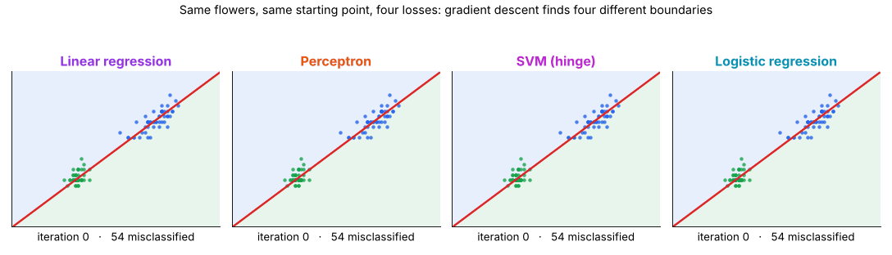
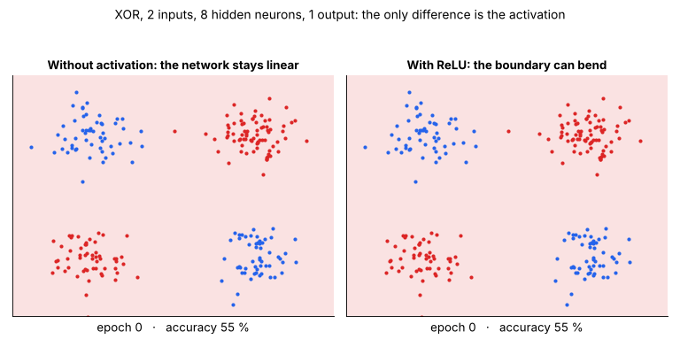
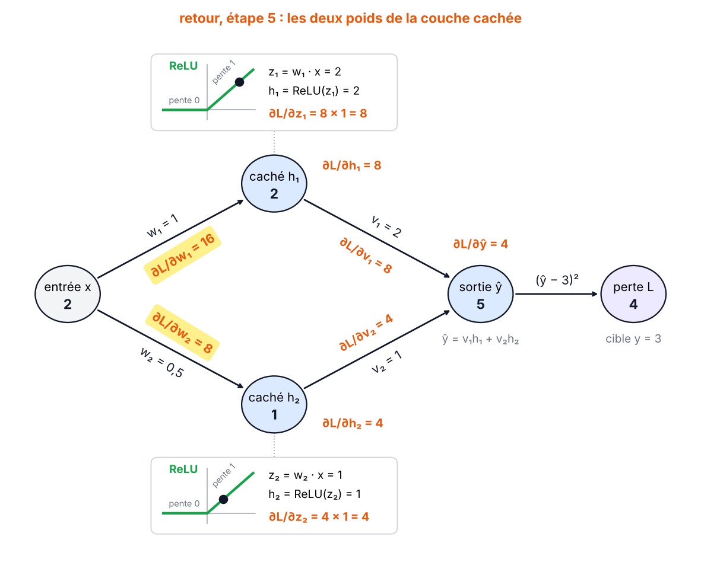
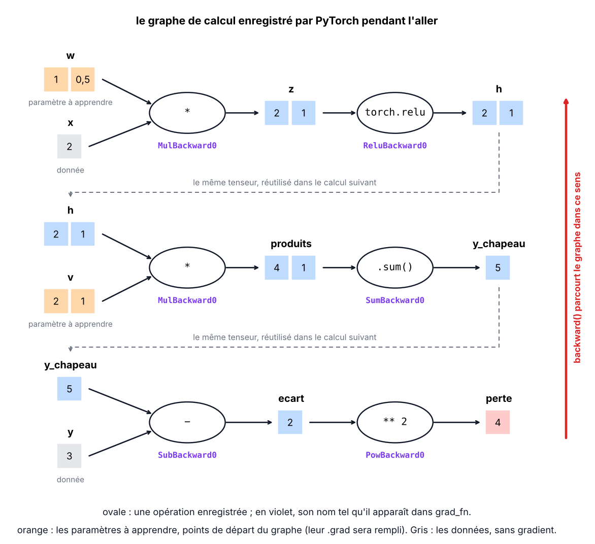
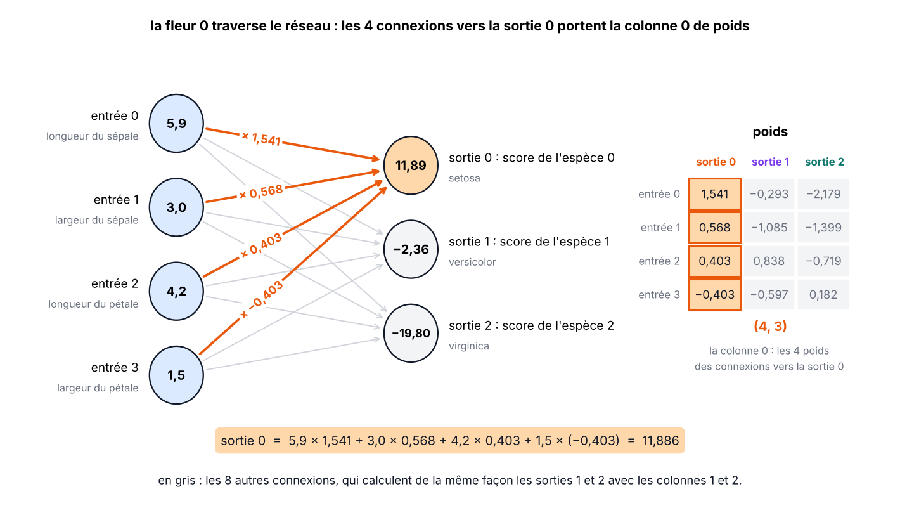
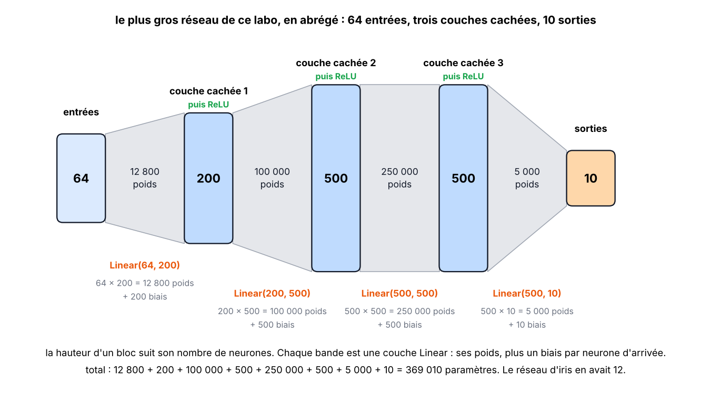
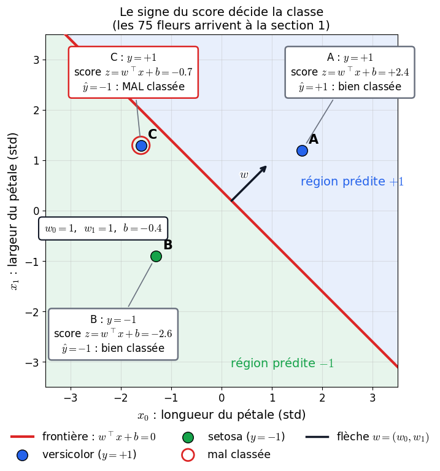
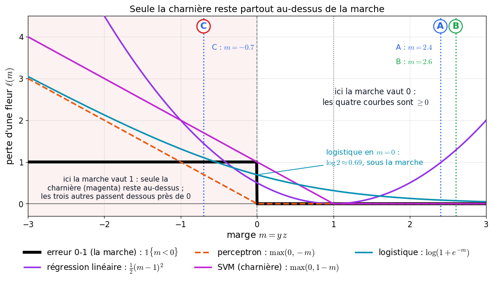
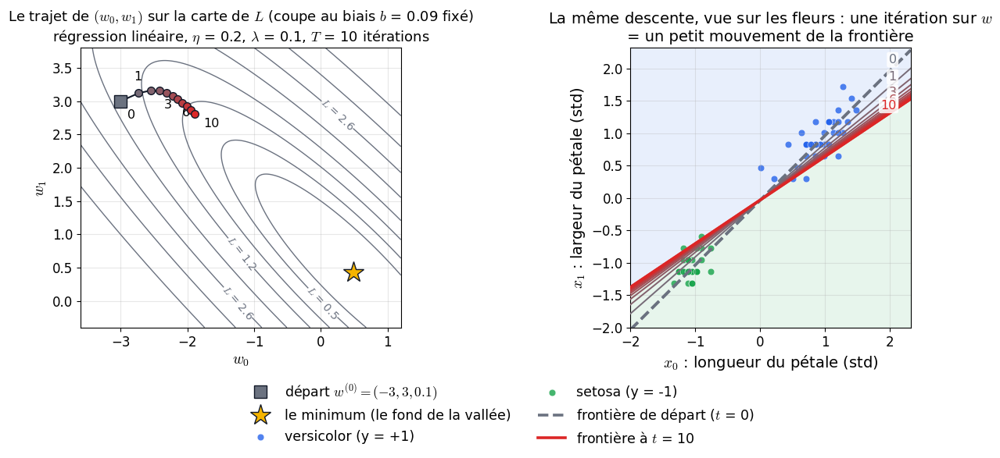
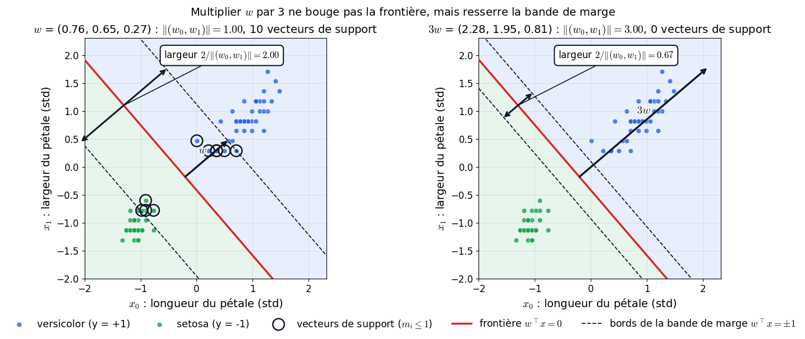

# Fundamentals of Machine Learning (IFT3395 / IFT6390), taught with simulations

Teaching material I designed as a **lecturer and teaching assistant** for IFT3395 / IFT6390, *Fundamentals of Machine Learning*, at Université de Montréal (Mila), Fall 2026, French section. The course is taught by Ioannis Mitliagkas and Dhanya Sridhar; the labs in this repository extend the official course labs.

The material follows one rule: a student should be able to **predict** what an algorithm will do, **test** the prediction on a simulation, and then **derive** the result step by step with real numbers.

**[Open the interactive demos](https://yanis-bencheikh.github.io/ML_Course_Bencheikh_Mila_UdeM_ift6390/)** · **[Read the PyTorch notebook, rendered](https://yanis-bencheikh.github.io/ML_Course_Bencheikh_Mila_UdeM_ift6390/notebooks/lab8_pytorch.html)** · [](https://colab.research.google.com/github/yanis-bencheikh/ML_Course_Bencheikh_Mila_UdeM_ift6390/blob/main/notebooks/lab8_pytorch/IFT3395_Lab8_PyTorch.ipynb)

<p align="center">
  <a href="https://yanis-bencheikh.github.io/ML_Course_Bencheikh_Mila_UdeM_ift6390/lab4.html#descent"></a>
</p>
<p align="center">
  <a href="https://yanis-bencheikh.github.io/ML_Course_Bencheikh_Mila_UdeM_ift6390/lab8.html#xor"></a>
</p>

The two animations above are previews. Click either one to open the live version, where the sliders are yours.

## Contents

| Lab | Topic | Material here | Live |
|---|---|---|---|
| Lab 8, 17 Nov 2026 | Introduction to PyTorch: backpropagation by hand, tensors, autograd, `optim`, `nn` | [Notebook](notebooks/lab8_pytorch/IFT3395_Lab8_PyTorch.ipynb) (370 cells, 61 figures, 5 slider demos), 2 browser simulations | [Demos](https://yanis-bencheikh.github.io/ML_Course_Bencheikh_Mila_UdeM_ift6390/lab8.html) · [Notebook](https://yanis-bencheikh.github.io/ML_Course_Bencheikh_Mila_UdeM_ift6390/notebooks/lab8_pytorch.html) |
| Lab 4, 27 Oct 2026 | Linear classifiers and gradient descent: linear regression, perceptron, SVM, logistic regression | 3 browser simulations, selected figures | [Demos](https://yanis-bencheikh.github.io/ML_Course_Bencheikh_Mila_UdeM_ift6390/lab4.html) |

The notebooks are written in French, the language of the section. The browser simulations and this page are in English.

## Interactive simulations

GitHub does not run notebook widgets, so the key simulations of each lab are rebuilt as dependency-free web pages (plain JavaScript and canvas, served by GitHub Pages from [`docs/`](docs)).

| Simulation | What the student manipulates | What it shows |
|---|---|---|
| [Place the boundary by hand](https://yanis-bencheikh.github.io/ML_Course_Bencheikh_Mila_UdeM_ift6390/lab4.html#boundary) | Direction, scale and offset of **w** | The 0-1 error ignores the scale of **w**; the four surrogate losses do not |
| [One flower, four losses](https://yanis-bencheikh.github.io/ML_Course_Bencheikh_Mila_UdeM_ift6390/lab4.html#losses) | The margin *m = y·z* of one flower | Each loss and its slope ℓ′(m), the force with which the flower pulls on **w** |
| [Gradient descent, one iteration at a time](https://yanis-bencheikh.github.io/ML_Course_Bencheikh_Mila_UdeM_ift6390/lab4.html#descent) | Loss, step η, regularisation λ, iteration *t* | The path on the map of *L(w)*, the zigzag and the divergence when η is too large |
| [Backpropagation by hand](https://yanis-bencheikh.github.io/ML_Course_Bencheikh_Mila_UdeM_ift6390/lab8.html#backprop) | Four weights, the input and the target | Forward values, the five steps of the chain rule, a finite-difference check, inactive ReLU neurons |
| [Why a network needs a non-linearity](https://yanis-bencheikh.github.io/ML_Course_Bencheikh_Mila_UdeM_ift6390/lab8.html#xor) | Activation, width, learning rate | A network trained live in the browser on XOR, with the backward pass written by hand |

Every simulation uses the same ritual as the labs: a prediction to make first, the simulation, then the answer.

## Lab 8: introduction to PyTorch

The lab starts without any library. A network with one input, two hidden ReLU neurons and four weights is computed forward and backward by hand; PyTorch then reproduces the same numbers (gradients 16 and 8 for the hidden weights, 8 and 4 for the output weights) before the lab scales up to iris, XOR and handwritten digits.

| | |
|---|---|
|  |  |
| The backward pass, one step per figure, with each gradient written on its edge. | The computation graph that autograd records, read from `grad_fn`. |
|  |  |
| Every matrix operation has its figure with the real numbers, placed before the code. | Large networks are drawn in a compact convention introduced on a small one (369,010 parameters here). |

Outline of the notebook:

1. Reminder by hand: a network computes, then learns (forward pass, chain rule, one descent step)
2. Why PyTorch: the number of gradients per step, from 4 to billions
3. Tensors: shapes, matrix products element by element, broadcasting, GPU
4. Autograd: the computation graph, `backward()`, accumulation over a batch, `zero_()` between epochs
5. Gradient descent written by hand on iris
6. `optim` and `nn`: the same loop without writing it
7. Stacking layers, and why a non-linearity is needed (XOR)
8. Recognising handwritten digits (cross-entropy, a 64-32-10 network)
9. What to remember

## Lab 4: linear classifiers and gradient descent

Four classifiers are presented as one model with four losses. Each loss is a function of the margin *m = y·z*, and the four gradients share one line of code: the mean of ℓ′(mᵢ)·yᵢ·xᵢ, plus λ**w**.

| | |
|---|---|
|  |  |
| The model in one image, with three reference flowers followed through the whole lab. | The four losses against the 0-1 error they replace. |
|  |  |
| The same descent seen on the map of the objective and on the flowers. | The SVM margin band and its support vectors as λ changes. |

The lab notebook (French, 13 slider demos) is not published here yet: it contains worked code for cells that students write themselves in a graded assignment.

## How the material is built

- **Predict, then check.** Each simulation is preceded by a prediction question and followed by its answer.
- **One idea at a time.** One sentence per cell in large type; at most one paragraph before the next figure or code cell.
- **Figure first, with real numbers.** The order is constant: idea, figure, explanation of the code, then the cell. Every matrix operation is drawn with the actual values before it is computed.
- **No skipped step.** Each derivative is obtained line by line with a justification per line, first for a single weight, then in matrix form. Each analytic gradient is compared with a finite difference.
- **Every element of code is explained before its first use.** In the PyTorch lab, each function, method, attribute and operator is named and described in the text that precedes the cell.
- **Every printed number is labelled** with how to read it, and tensor shapes are followed after every layer.
- **Checked by execution.** The notebooks run from top to bottom without error, and each demo is called again after every cell to make sure no later cell breaks it.

## Repository layout

```
notebooks/lab8_pytorch/     the PyTorch lab (Jupyter / Colab, French)
docs/                       GitHub Pages site: interactive simulations and the rendered notebook
docs/assets/ml.js           the mathematics of the simulations (losses, gradients, backpropagation, a small MLP)
scripts/test_ml.js          checks that mathematics against the numbers worked out by hand in the labs
scripts/make_assets.py      regenerates the data file and the two animations of this page
assets/                     figures and animations used in this README
```

## Running it

```bash
# the simulations: any static server
python -m http.server --directory docs 8000

# the checks (Node 18 or later)
node scripts/test_ml.js

# the animations and the data file
pip install -r requirements.txt
python scripts/make_assets.py
```

The notebook runs in Colab with the badge at the top of this page, or locally with Jupyter after `pip install -r requirements.txt`. It was tested on CPU.

## Credits

Material by Yanis Bencheikh (Mila, Université de Montréal, HEC Montréal). It extends the official labs of IFT3395 / IFT6390 prepared by the course's teaching team. Data: Fisher (1936), iris; scikit-learn's digits. Detailed references are listed at the end of each notebook.

For reuse in a course, please get in touch.
